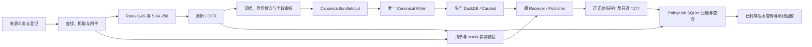

# CRPD 当前架构与开发入口

核对日期：2026-11-25。CRPD 与 CRPD-E 是同一项目在迁移前后的开发入口。现行工作树、数据和发布链以 E 盘部署为准。本文描述这些模块及其接口。运行状态和每批业务进展以当前指针和原生回执为准。

## 数据怎样进入查询端

图中的箭头表示数据交接。存量载体、来源补证、正式身份写入各有自己的准入与回执。来源补证经原 Receiver 和 Publisher 发布时，可以增加可读来源而保持正式身份与版本索引不变。MAIN 校验交付清单、原件和 SHA，落库后产生归档回执；正式发布要继续核对原生接收、提交指针、HTTP 与 SQL 读回。发布读回超时沿原提交标记续查，遇到指针或绑定漂移保留 UNKNOWN 和失败证据。

| 层 | 所有权与接口 |
| --- | --- |
| 采集 | 采集 Worker 依照现有生产者合同分派来源任务，保存原始 URL、最终 URL、响应、附件、解析状态和证据。批次先写文件，最后原子提交 `DELIVERY_MANIFEST.json`。 |
| 归档 | MAIN 校验清单与实际字节。按文件 SHA 去重保存，保留原始载体、工作表、行、单元格及各处出现记录。读 `MAIN_STATUS.json` 和批次 `MAIN_RECEIPT.json`。 |
| 治理与准入 | 分开记录来源、政策实体、正式版本、政策动作及原文证据。地区、发文机关与适用范围分列，候选值保持原始证据、方法、置信度和审核状态。 |
| Canonical 写入 | 既有 owner 通过 `CanonicalBundleInput` 与唯一 Writer 写生产 DuckDB。模型、枚举、质量、身份和幂等校验在写入前执行。保留失败、未知投递及请求保护。 |
| 版本发布 | 原 Receiver / Publisher 验证范围，提交固定的当前指针与清单。每次发布保留版本、时间、哈希、验证报告及回执。 |
| PolicyHub | 4177 提供当前发布的检索和详情。SQLite 保存发布字节、存量原行、交付及追溯关系，查询入口包括 `stock`、`current_records`、`current_assets` 与 `delivery_file`。离线回放使用已封存的完整版本。 |
| 研究 | 从具有明确版本和数据字典的 Curated 或发布快照生成研究表。记录样本范围、缺口和派生口径。 |

Archive-First 分四级：L1 抓取 Raw、附件与解析，L2 身份与 Canonical，L3 字段治理，L4 研究验收。L1 可独立推进。L1 成功、MAIN 归档、正式接收、已发布、研究可用分别由各层回执证明。未知及未扫描窗口保留未知。

## 文件和运行入口

- 仓库 `src/policydb/` 管 Python 数据模型、抓取、治理、导入导出与读取契约。历史 Dashboard 的入口在 `app/`，调度和运维入口在 `scripts/`，数据库迁移与测试在 `migrations/` 和 `tests/`。
- 现行本机环境由独立代码树与数据树组成。在 Windows 部署中，`policy-database` 是代码根，数据根含 `database/policydb.duckdb`、历史资料和 `PolicyHub/`。后者的 `main_agent.py`、`capture_pipeline.py`、`producer_contract.json`、`published_reader.mjs` 和 `vite.sql-preview.config.mjs` 对应交接、归档与 SQL 读面。
- 数据根之外保留 Receiver、Publisher、维护证据及版本恢复资料。维护批次使用自身的冻结范围、原生回执及校验结果；截至本文日期，一部分本机实现及维护材料随工作区定位，公开 Git 仓库描述其接口。
- 按现行工作区的接续说明定位原角色与最新回执。开发先检查相关 CodeGraph 模块、领域规则和既有测试。数据模型变更同步更新字典、迁移和测试；发布相关改动另核发布守卫和提交后的实际读回。
- 旧版模块说明见 [架构文档](ARCHITECTURE.md)、[数据模型](data_model.md) 和 [E 盘迁移记录](MIGRATION_E_DRIVE.md)。涉及当前运行身份时，以实际监听、进程、当前指针和原回执交叉核对。
